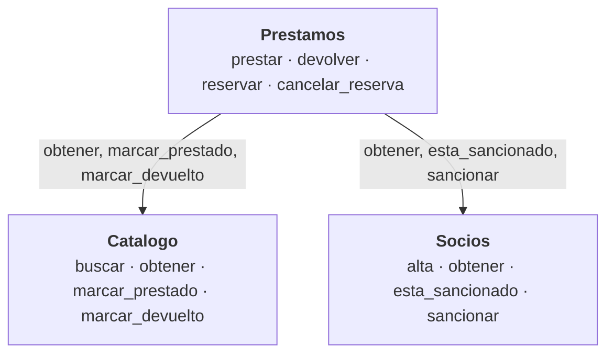

# Biblioteca de barrio

Primera versión de la aplicación de una biblioteca de barrio, separada en **tres componentes** que colaboran sin conocer el interior de los demás. Hay dos versiones con la misma arquitectura y las mismas reglas:

- **Consola (Python):** `catalogo.py`, `socios.py`, `prestamos.py` y `main.py`.
- **Web (GitHub Pages):** carpeta `docs/`, en HTML + JavaScript puro, sin dependencias.

## Arquitectura



El mismo diagrama, en imagen: [`diagrama.svg`](diagrama.svg).

| Fichero | Papel |
|---|---|
| `catalogo.py` | Componente. Clases `Libro` y `Ejemplar`. No depende de nadie. |
| `socios.py` | Componente. Clase `Socio`. No depende de nadie. |
| `prestamos.py` | Componente. Clases `Prestamo` y `Reserva`. Depende de Catalogo y Socios, **solo por sus funciones públicas**. |
| `main.py` | Menú de consola. No es un componente: solo los junta. |

**Encapsulación:** cada componente declara su interfaz en `__all__`; lo que empieza por `_` es interior. Las funciones públicas devuelven copias de los objetos, así que nadie de fuera puede cambiar el estado por la puerta de atrás. Una prueba automática comprueba que `prestamos.py` no toca nada privado de los otros componentes.

## Reglas implementadas

| Regla | Dónde |
|---|---|
| Un socio no puede tener más de 2 libros a la vez | `prestamos.prestar` (`MAX_PRESTAMOS = 2`) |
| Cada préstamo caduca a los 7 días | `Prestamo.fecha_vencimiento` (`DIAS_PRESTAMO = 7`) |
| Cada título tiene varios ejemplares con su propio estado | `catalogo.Libro.ejemplares`, `catalogo.Ejemplar.estado` |
| Un socio sancionado no puede pedir libros | `prestamos.prestar` y `prestamos.reservar` consultan `socios.esta_sancionado` |
| Se pueden reservar libros ya prestados | `prestamos.reservar`: cola por orden; el ejemplar devuelto se guarda para el primero |

Decisiones de diseño que el enunciado no fijaba: devolver con retraso sanciona tantos días como de retraso; una reserva de un socio sancionado no bloquea el libro para los demás; el socio sancionado tampoco puede reservar.

## Decisión sobre la petición del cliente

Ver [`diario.md`](diario.md). Resumen: **no** se hace que Prestamos lea la lista de libros de Catalogo, para no depender de su interior.

## Ejecutar la versión de consola

Requiere Python 3.9 o superior, sin librerías externas.

```bash
python3 main.py
```

La opción 7 del menú adelanta la fecha para probar la caducidad de los préstamos y las sanciones sin esperar días reales.

Pruebas:

```bash
python3 -m unittest discover -s tests -v
```

## Ejecutar y probar la versión web

```bash
cd docs
python3 -m http.server 8000      # abrir http://localhost:8000
node --test test/biblioteca.test.js   # pruebas (Node 18 o superior)
```

(Hay que servirla por HTTP; abrir `index.html` con doble clic no funciona porque los módulos de JavaScript lo bloquean en `file://`.)

## Publicar en GitHub Pages

1. Crea un repositorio nuevo en GitHub (por ejemplo `biblioteca`) y sube el proyecto:
   ```bash
   git init
   git add .
   git commit -m "Biblioteca de barrio: tres componentes y versión web"
   git branch -M main
   git remote add origin https://github.com/TU_USUARIO/biblioteca.git
   git push -u origin main
   ```
2. En GitHub: **Settings → Pages → Build and deployment → Source: Deploy from a branch**, rama **main**, carpeta **/docs**, y **Save**.
3. Espera uno o dos minutos. La web quedará en:

   `https://TU_USUARIO.github.io/biblioteca/`

   Ese es el enlace que hay que entregar.
